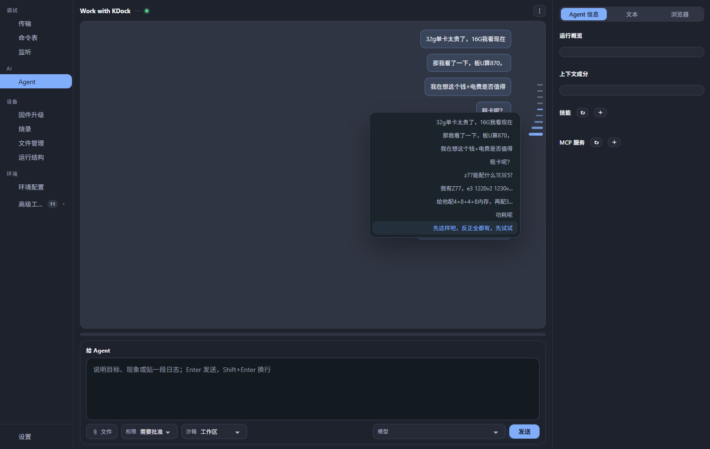
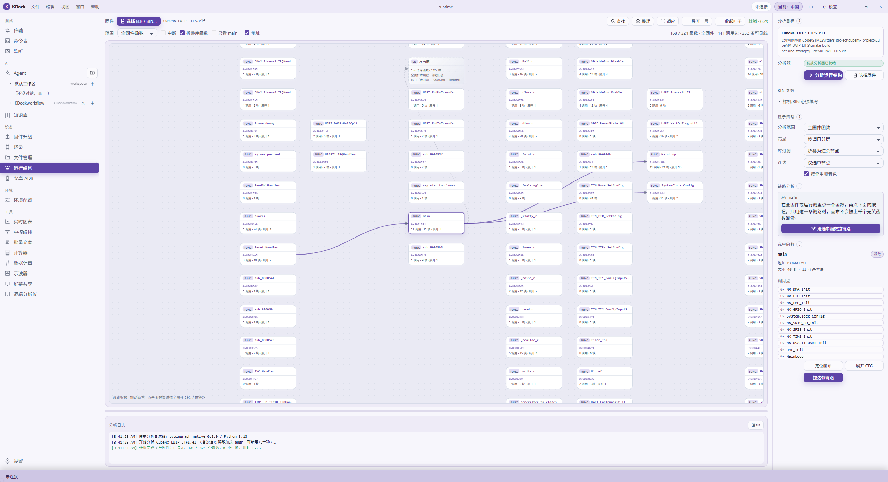
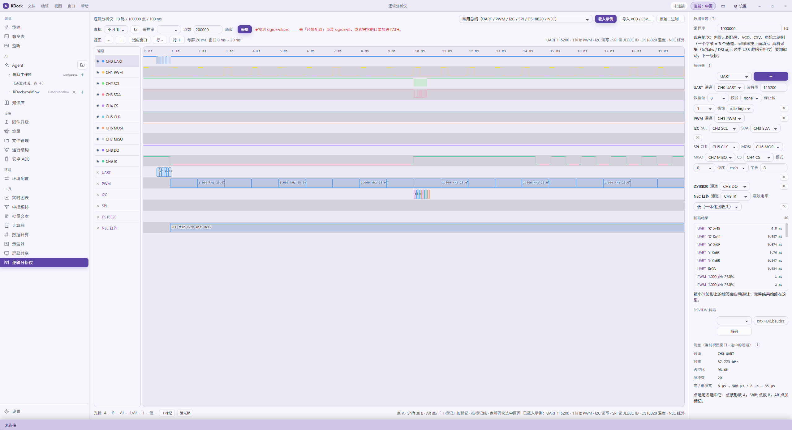

<div align="center">


# KDock

**Serial debugging, flashing, firmware analysis and an AI Agent in one Windows workbench.**

Go from connecting a device to finding the problem, flashing a fix and automating the workflow without juggling separate tools.

[](https://github.com/Kyin-code/KDock/actions/workflows/ci.yml)
[](https://github.com/Kyin-code/KDock/releases/tag/test-latest)
[](LICENSE)


[中文](README.md) ｜ **English**



</div>

## Why KDock

- **One link through the whole debug loop**: serial, networking, SSH, device files, flashing, firmware analysis and instruments share context.
- **An Agent that can do the work**: it calls real KDock tools, edits workspaces, operates devices and runs commands, subject to permission checks.
- **Built for embedded work**: call graphs, registers, logic captures and firmware updates are part of the same desktop workflow.

## Two-minute start

1. Open [test-latest](https://github.com/Kyin-code/KDock/releases/tag/test-latest).
2. Download `KDock-*-win-x64.zip`, extract it and run `KDock.exe`.
3. Connect a serial or network link on the Transfer page; press `F1` elsewhere for contextual help.

An NSIS installer (`KDock_*_x64-setup.exe`) is also available. Windows x64 and WebView2 Runtime are required.

> Test builds are unsigned Pre-releases and may trigger SmartScreen.
> In-app updates are downloaded and SHA-256 verified; installation still requires explicit confirmation.

## What it does

| Area | Capabilities |
| --- | --- |
| Links and transfer | Serial, TCP/UDP, SSH, USBPcap, tshark, FTP/FTPS/TFTP |
| Devices and flashing | `.fw` upgrade, vendor bootloaders, OpenOCD/J-Link/pyOCD/WCH-Link, ADB |
| Firmware analysis | ELF/BIN runtime graph, call chains, upstream/downstream highlighting, CFG, interrupts and RTOS detection |
| Instruments and data | Oscilloscope, logic analyzer, live charts, batch text, calculator and workflow |
| Agent and automation | Workspaces, skills, MCP, shared browser, Windows UI automation, subagents, command sandbox and schedules |

The Agent supports OpenAI-compatible and Anthropic providers, so you can bring your own model service.
Repeatable debug steps can be stored as workflows, skills or `AGENTS.md`.

## Build from source

Requires Windows x64, Node.js 18+, Rust 1.80+ (MSVC toolchain) and Tauri 2 dependencies.

```powershell
git clone https://github.com/Kyin-code/KDock.git
cd KDock
npm ci

# Build the portable runtime analyzer on first setup, about 500 MB
pwsh -NoProfile -ExecutionPolicy Bypass -File tools/bingraph/build-portable.ps1 -NoGraphviz

# Development
npm run tauri dev

# Tests
npm run test:vite:pages
cargo test --workspace --locked

# Release package with automatic version bump
npm run tauri build
```

Outputs:

```text
target/release/kdock.exe
target/release/bundle/nsis/KDock_<version>_x64-setup.exe
```

Do not replace `npm run tauri build` with `cargo build --release`; frontend assets will not be packaged correctly.

## Screenshots

> UI preview only. Use the in-app `F1` help for actual workflows.

| Runtime graph | Logic analyzer |
| --- | --- |
|  |  |

## Project layout

```text
src/                    Vite frontend
src-tauri/              Tauri 2 / Rust backend and Agent
crates/kdock-core/      Serial, HEX, line endings and session core
tools/bingraph/         Portable firmware analyzer source and build scripts
resources/bingraph/     Generated bundle, not tracked by Git
docs/                   Protocol, algorithm and feature documentation
```

## Contributing

- Open an Issue with the KDock version, Windows version and relevant logs.
- Before a PR, run `npm run test:vite:pages`, `npm run build` and `cargo test --workspace --locked`.
- Include help text, tests and third-party license updates where applicable.

## Open source and licensing

KDock itself is [Apache-2.0](LICENSE). Core dependencies:

| Project | Purpose | License |
| --- | --- | --- |
| [Tauri](https://github.com/tauri-apps/tauri) | Desktop framework | MIT OR Apache-2.0 |
| [uPlot](https://github.com/leeoniya/uPlot) | Live charts | MIT |
| [pybingraph](https://github.com/manelfx/pybingraph) | Firmware function/CFG analysis | BSD-2-Clause |
| [angr](https://angr.io/) | Binary analysis and symbolic execution | BSD-2-Clause |
| [Python](https://www.python.org/) | Portable analyzer runtime | PSF-2.0 |
| [Cytoscape.js](https://js.cytoscape.org/) | Analyzer offline graph UI | MIT |

The firmware analyzer runs as an independent Python child process. Release artifacts retain
licenses and notices for 78 Python distributions. `pyvex` contains LibVEX
(`GPL-2.0-or-later`); KDock does not modify it and uses it only in that separate process.
See [NOTICE](NOTICE) and the
[third-party inventory](tools/bingraph/THIRD_PARTY_NOTICES.md).

USBPcap, tshark, sigrok, ADB/scrcpy, DSView, J-Link and OpenOCD are optional external tools.
KDock invokes user-installed programs and does not bundle or relicense them.

## Documentation

- [Firmware packages and upgrade protocol](docs/01-固件包格式与打包算法.md)
- [Flashing and external programmers](docs/05-烧录-外部烧录器.md)
- [Device file transfer](docs/06-设备文件传输.md)
- [Logic analyzer validation](docs/09-逻辑分析仪-准确性与解码自测.md)
- [Firmware runtime analyzer](docs/10-固件运行结构分析器.md)
- [Changelog](CHANGELOG.md)
