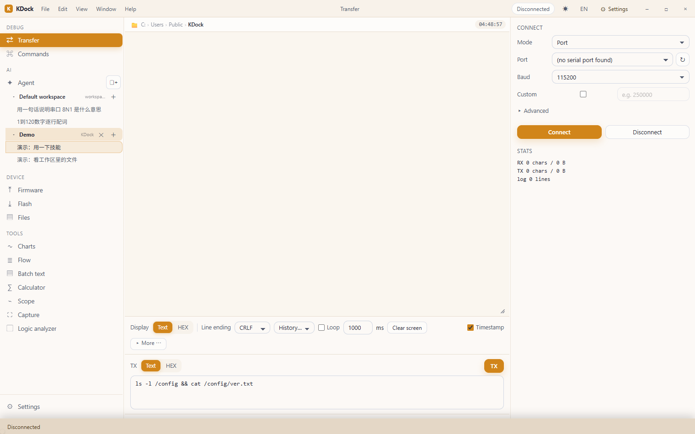
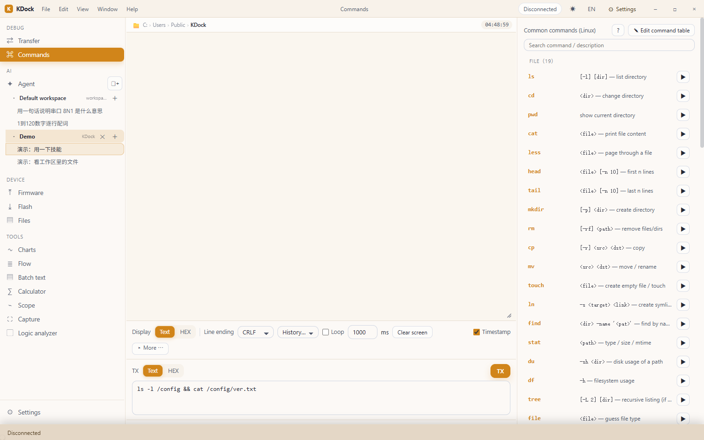
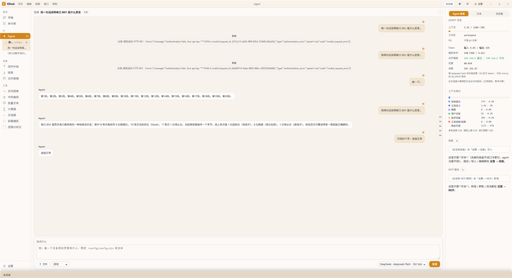
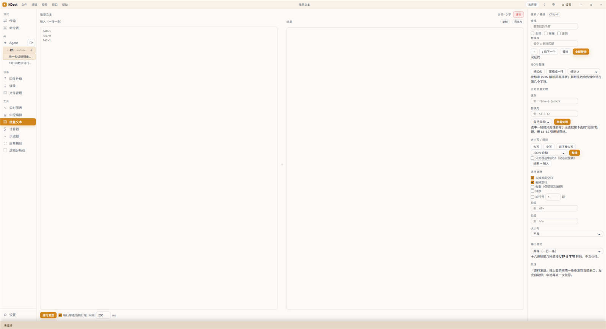
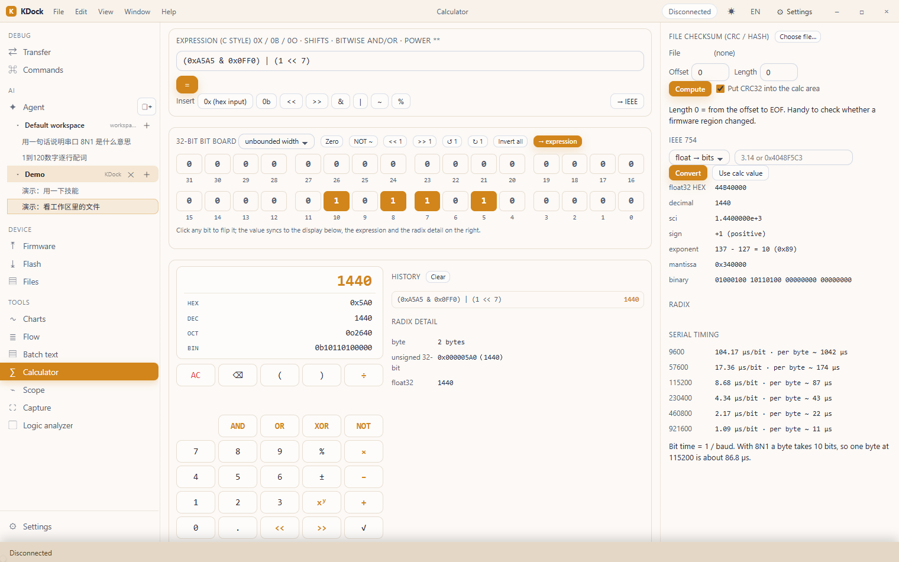
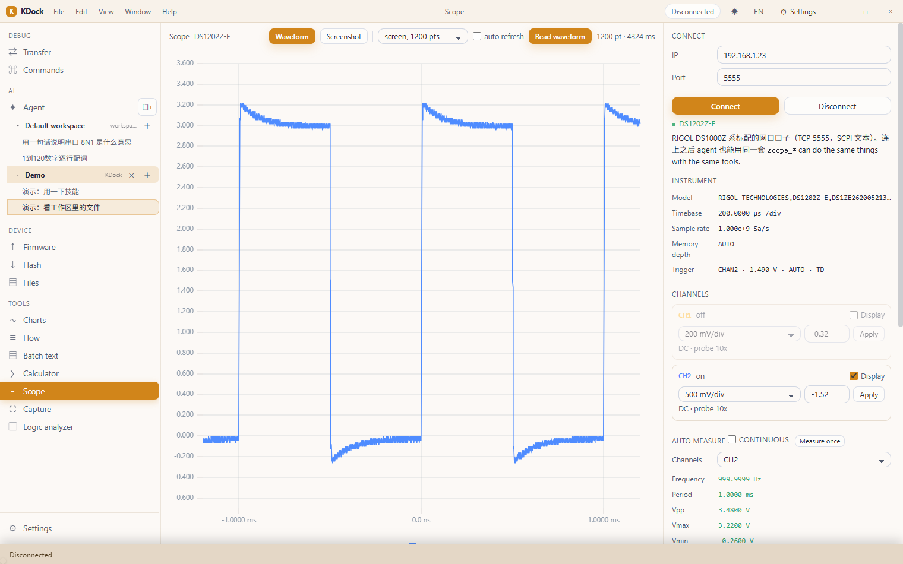
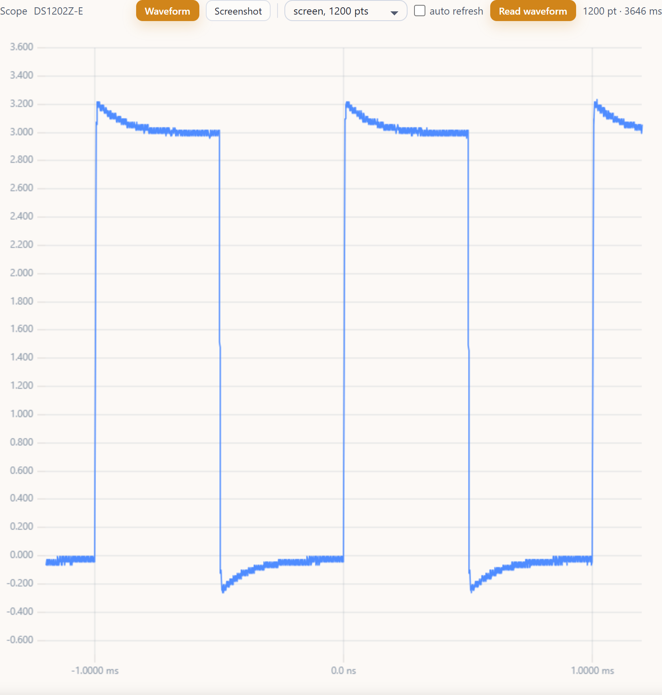
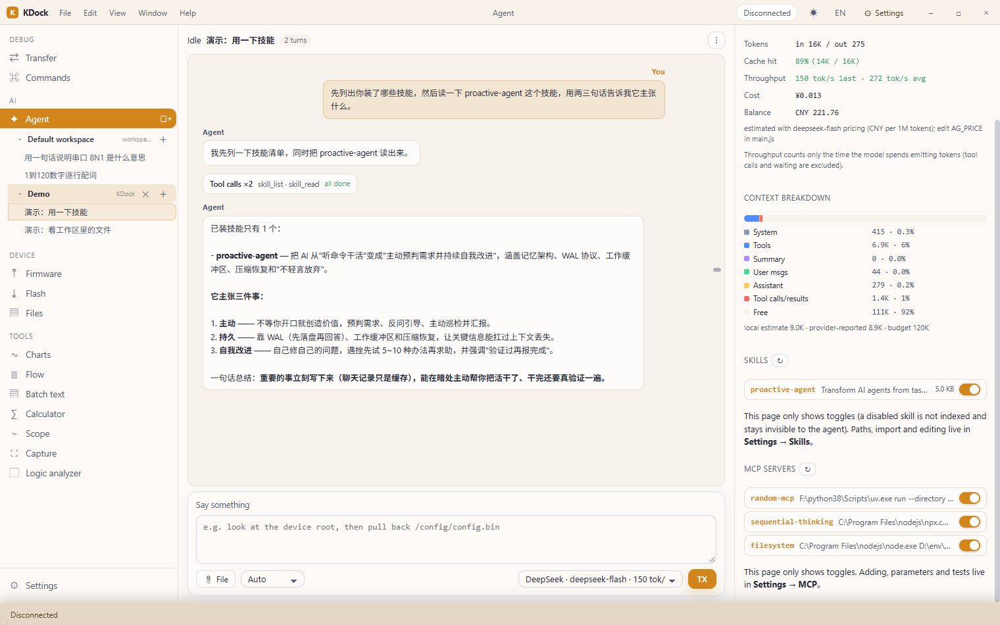

<div align="center">


# KDock

**A desktop workbench for embedded development: serial / network debugging · firmware upgrade (OTA) · flashing · device files · an AI assistant that actually does things**

Serial & network I/O, a command reference, firmware packaging/upgrade/flashing, device file transfer,
live charts, flow orchestration — plus an Agent that can drive all of it. All in one window.

[](LICENSE)


[中文](README.md) ｜ **English**

</div>

---

## Download (test builds)

> ⚠️ **There are no stable releases yet — only automatically built test builds.** They follow `main`:
> they may crash or change your settings, so please back up and do not use them in production.

**[⬇ Latest test build](https://github.com/Kyin-code/KDock/releases/tag/test-latest)** — CI rebuilds it on every
push to `main`, so this link always points at the newest one. GitHub marks it as a **Pre-release**.
([All releases](https://github.com/Kyin-code/KDock/releases))

| File | What it is |
| --- | --- |
| `KDock-*-win-x64.zip` | **Portable** — unzip and run `KDock.exe` |
| `KDock_*_x64-setup.exe` | **Installer** (NSIS) — installs for the current user, adds a Start menu entry, uninstalls cleanly |
| `kdock.exe` | The bare executable |

- The binaries are **not code-signed**: Windows SmartScreen may warn on first launch (More info → Run anyway);
- The **WebView2 Runtime** is required (usually present on Windows 10/11; the app offers to install it if missing);
- Only Windows x64 packages are built right now.

---

## What it does

| Area | Capabilities |
| --- | --- |
| **Transfer** | Serial (all parameter combinations), TCP/UDP client & server, HEX/text modes, line endings, encoding switch, session logs & replay, ANSI terminal rendering, quick-send buttons |
| **Helpers** | Command reference (standard Linux commands), batch text processing, calculator (with a 32-bit bit board, IEEE 754 and file checksums) |
| **Firmware** | `.fw` package parsing & verification, **serial in-app upgrade (YMODEM)**, **network upgrade (service channel)**, version manifest from an HTTP server |
| **Flashing** | Drives external programmers (OpenOCD / J-Link / STM32CubeProgrammer) for flash, erase, verify and reset |
| **Environment** | One-click detection and install of drivers / toolchains (CH34x · FTDI · J-Link+JFlash · arm-none-eabi-gcc · OpenOCD · PulseView(sigrok) · RT-Thread Env · ST-Link · Zadig): read-only scan of this PC (PATH / registry / pnputil / common folders), bundled installers first, winget / git one-click install, first-run check for required drivers |
| **Device files** | List directories, pull/push files, CRC verification (serial uses base64, network uses offset-based reads/writes) |
| **Visualization** | Live charts (multi-channel), screen capture, **oscilloscope** (RIGOL DS1000Z series over SCPI: state, 13 auto-measurements, multi-channel waveform, screenshot, timebase/trigger control), logic analyzer (waveform / 19 protocol decoders / import VCD·CSV·raw / **real-device capture through sigrok-cli**: fx2lafw, old Saleae Logic, saleae-logic16, DSLogic …) |
| **Flow** | Chain local commands / TCP / UDP / serial into a timed flow with branches, run it with one click |
| **AI Agent** | Built-in assistant that can call all of the above; OpenAI-compatible and Anthropic protocols, skills (`SKILL.md`, each can be marked "Always on" = its body goes into the system prompt every turn, which is how you shape a persona / tone), MCP servers, context compaction, throughput and cost stats |

## Screenshots

**Transfer: serial / network I/O with HEX view and session log**



**Command reference: standard Linux commands, click to fill the send box**



**Agent: a conversational assistant that can read/write the device, upgrade and flash**



**Batch text: de-duplicate/sort/convert multiple lines, send line by line**



**Calculator: C-style expressions, keypad, 32-bit bit board, file checksums**



**Oscilloscope: RIGOL DS1000Z series over SCPI — state, auto-measurements, multi-channel waveform, screenshot**



**The waveform view inside KDock: channels overlaid, values on hover (here the 1 kHz square wave on CH2)**



**Agent info page: skill and MCP switches, context breakdown, cache hit rate and cost — the agent reads skills on demand**



## Quick start

1. Open **Transfer**, pick a serial port (or TCP/UDP) and click Connect;
2. Type in the send box — `Enter` sends, `Shift+Enter` inserts a newline; HEX looks like `41 54 0D 0A`;
3. To upgrade firmware: **Firmware** → pick a local `.fw` or enter a server address → choose the serial or
   network channel → start;
4. To flash a chip: **Flash** → choose the programmer and target → pick the file → flash;
5. Want a hand? Open **Agent**, configure a model (provider + API key) in Settings, and just ask.

## UI tour

### Transfer

- Serial parameters (baud / data bits / stop bits / parity / flow control) and network parameters live in the
  right pane; link state shows in the title bar and as a status dot;
- The output pane supports HEX/text switching, timestamps, TX/RX colouring, pause & scroll-back, log export;
- **Terminal mode** renders the ANSI sequences a device sends (backspace, redraw, cursor moves) so it behaves
  like a real terminal;
- Quick-send buttons are yours to edit.

### Commands

A reference of standard Linux commands grouped into files / text / system / network / permissions, each with an
argument template. Click the name to fill the send box, or `▶` to send it right away. The filter searches both
names and descriptions.

### Firmware

- **Package**: `.fw` = a 64-byte header (magic / version / payload CRC / header CRC / board name) + the image;
- **Channels**: serial (device-side YMODEM in-app upgrade) or network (offset writes over the service port,
  verification, upgrade flag, reboot);
- **Sources**: a local file, or a version manifest served over HTTP (sorted by version, verified after download);
- Every step reports progress, and failures say *which* step got stuck in plain language.

### Flash

The UI only builds the command line and streams the programmer's output; OpenOCD / J-Link / STM32CubeProgrammer
are supported. Tool paths, adapters, targets and speeds are remembered after you set them once. Great for
first-article boards, bricked boards and production lines.

### Files

List a device directory, pull/push files, verify CRC32 — over serial (`base64`) or the network service channel.

### Charts / Capture / Scope / Flow

- Send `1.23,4.56,7.89` one line at a time and the chart splits it into channels automatically;
- Screen capture uses the OS desktop duplication API with adjustable frame rate and quality;
- The **oscilloscope** speaks RIGOL DS1000Z-series SCPI — see its own section below;
- Flow orchestrates several links into a timed sequence with branches, timeouts and logs.

### Batch text / Calculator

- **Batch text**: de-duplicate / sort / add prefix·suffix / number lines, convert to HEX array, HEX string,
  JSON, CSV or a C array; find & replace (Ctrl+F, whole word, fuzzy, regex), JSON formatting, regex batch runs,
  case and indent cleanup (selection-aware), and line-by-line sending with a delay;
- **Calculator**: C-style expressions (`0x/0b/0o`, `<< >> & | ~ % **`, hand-written parser — no `eval`),
  a traditional keypad, a **32-bit bit board** (click any bit; the value feeds back into the expression),
  IEEE 754 float ↔ bits (with sign/exponent/mantissa breakdown), radix conversion and **file checksums**
  (CRC32 / CRC16-CCITT / CRC16-MODBUS / MD5 / SHA1 / SHA256, optionally over a byte range).

## Oscilloscope

It talks over the LAN port every RIGOL DS1000Z / DS1000Z-E series scope (DS1054Z, DS1202Z-E, …) has:
**TCP 5555, SCPI text**.

- **State**: model (`*IDN?`), each channel's on/off, V/div, offset, coupling and probe, timebase,
  sample rate, memory depth, trigger source and level;
- **Channel cards**: change V/div and offset and push them to the scope with one click;
- **Auto-measurements**: frequency, period, Vpp, Vmax/Vmin, Vavg, Vrms, Vtop/Vbase, rise/fall time,
  duty+/duty- — 13 items, optionally refreshed every two seconds. A channel with no signal shows `—`
  (the scope returns 9.9E37, which is treated as "not measurable");
- **Waveform**: every enabled channel on one plot (one colour per channel, cursor readout) with the
  1200 on-screen points, or deep memory (the UI says so when memory depth AUTO only gives 1200 points);
- **Screenshot**: grabbed from the scope (`DISP:DATA?` returns a binary PNG at the native 800×480) and shown in
  place, saveable as PNG;
- **Control**: timebase, trigger source, trigger level, RUN/STOP, autoset, plus a raw SCPI console with a reply log.

The same abilities are exposed to the **Agent** as tools: `scope_connect` / `scope_info` / `scope_measure` /
`scope_waveform` (a summary plus an ASCII plot) / `scope_screenshot` (saved into the session workspace) /
`scope_control`, plus the raw `scope <cmd>`. So you can just say "check what CH2 looks like".

> Note: the DS1000Z SCPI socket accepts a **single** client at a time. KDock reconnects automatically when
> it gets kicked, but do not drive the scope from two programs at once.

## Environment setup

**Environment setup** (left nav → the **Environment** group): drivers and toolchains without hopping through
vendor sites — one scan, then install whatever is missing.

**Nine items**: CH34x / CH340 serial driver, FTDI FT2232 / D2XX, SEGGER J-Link (incl. JFlash / GDB Server / RTT),
GNU Arm Embedded Toolchain (arm-none-eabi-gcc), OpenOCD, logic analyzer (PulseView / sigrok), RT-Thread Env,
ST-Link USB driver, Zadig (WinUSB for FX2 logic analyzers).

**The scan is read-only** and never touches your machine: PATH plus a few extra roots, the driver list from
`pnputil /enum-drivers` (that is how CH34x / FTDI / ST-Link are recognized), the registry (J-Link's version),
and common folders on each drive (matched by pattern, not a full-disk walk). All nine scan in **0.3 s**
(measured), cached for 15 minutes; "Rescan" forces a refresh.

**Installing** goes in this order:

1. Is there a bundled installer in `<exe folder>\drivers\<item id>\` (`.exe` / `.msi` / `.inf`)? Then use it —
   **no network at all**. A few-MB driver (CH340 / FTDI, whose vendors gate the download behind a login) can
   ship next to the app this way.
2. Otherwise follow the plan: winget (official packages for the Arm toolchain / OpenOCD / PulseView / Zadig),
   git clone (RT-Thread Env), or download into your Downloads folder and run the installer.
3. Installing a USB driver raises **one UAC prompt** (`Start-Process -Verb RunAs`) — drivers need elevation and
   the app never bypasses it silently.

WCH / FTDI / SEGGER / ST gate their downloads behind a consent checkbox or a login, so there is no stable direct
link; those items get "Open website" + "I downloaded it — install from local" (drop the installer into the bundled
folder above). The **install folder** is yours to pick: portable items (toolchain zips / git repos) unpack there;
left blank it prefers `F:\ENV`, otherwise `KDock\env` under your user folder.

**First-run check**: runs once after startup and **only prompts when a required item is missing** (today the only
required one is the CH340 serial driver — without a COM port you cannot do anything). "Open it" jumps to the page,
"Cancel" stops the nagging; updatable items only raise a toast. **The app never downloads or installs anything by
itself** — even the scan is strictly read-only.

The same capabilities are on the **Agent**: `env_scan` (scan this PC, read-only, no approval — same inventory the
page shows) and `env_install` (install / update one item, **needs approval**; the UI switches to Environment setup
so the user watches the progress and log live).

## Using the Agent

The right pane has three tabs: **Agent info / Text / Browser**.

**Models**: configure providers in Settings → Model & provider (any OpenAI-compatible `base_url`, or Anthropic
format). Each profile stores its own key (DPAPI-encrypted per Windows user). The dropdown under the chat switches
between them and shows live load (AMD Radeon Cloud free models) plus the measured throughput.

**Permissions** (bottom of the chat):

| Level | Behaviour |
| --- | --- |
| Read-only | Device writes, file writes, shell commands and flashing are refused |
| Ask | Risky actions raise an approve/deny card first; switching to Auto releases anything already waiting |
| Auto | Everything runs immediately (and reports back) |

**Skills**: one `SKILL.md` each (name/description from the frontmatter go into the system prompt, the body is read
on demand). The Agent info page only toggles them; paths, import and editing live in Settings → Skills.
**Always on**: flipping the "Always on" switch on a skill row injects that skill's body into the system prompt
**every turn** (the system prompt is never trimmed or compacted) — that is what makes an identity / tone /
house-rules skill actually stick, i.e. "drop in a persona skill and the agent becomes that persona", without
editing the `SKILL.md` or the built-in role description. Combined limit 16 KB (enforced on both ends); its
token cost shows up as its own row in the context breakdown.

**MCP**: add stdio servers in Settings → MCP (`command` + `args` + `env`; the `command` array + `environment`
style used by other tools is accepted too). The Agent info page only toggles them. Remote HTTP servers are not
supported yet.

**Slash commands**: `/goal <text>` (standing goal, injected every round), `/compact`, `/new`,
`/perm ask|auto|read`, `/stop`, `/help`.

**Context & cost**: the Agent info page shows context usage, a breakdown (system prompt / tool schemas / summary /
user messages / assistant replies / tool calls), cache hit rate, estimated cost and throughput (measured only
while the model is actually emitting tokens).

## Protocol & algorithm docs

The upgrade, OTA package and flashing features have their own write-ups (Chinese):

| Document | Contents |
| --- | --- |
| [01 Firmware package format](docs/01-固件包格式与打包算法.md) | byte layout of the `.fw` header, version encoding, CRC algorithms, verification order |
| [02 Serial in-app upgrade](docs/02-固件升级-串口在线升级.md) | YMODEM flow, timeouts and retries, how to locate failures |
| [03 Network upgrade & service channel](docs/03-固件升级-网口服务通道.md) | SVC1/SVR1 frame format, command codes, sequence de-duplication, error codes |
| [04 Firmware server & versioning](docs/04-固件服务器与版本管理.md) | manifest formats, version comparison, post-download verification |
| [05 Flashing](docs/05-烧录-外部烧录器.md) | command lines for OpenOCD / J-Link / CubeProgrammer and troubleshooting |
| [06 Device file transfer](docs/06-设备文件传输.md) | serial base64 vs. offset-based network transfer |

## Building from source

Requirements: Node.js 18+, Rust 1.80+ (MSVC toolchain) and the Tauri 2 system dependencies.

```bash
npm install
npm run dev            # frontend only (pair with the command below)
npm run tauri dev      # dev mode: frontend HMR + Rust backend
cargo test --workspace # unit tests (run inside src-tauri, or pass --manifest-path)
npm run tauri build    # production build: Windows output is target/release/kdock.exe
```

> ⚠️ Always build with `npm run tauri build`. A plain `cargo build --release` produces a dev-mode binary that
> loads `devUrl` (`http://localhost:1420`) and shows the browser's "can't reach this page" without a dev server.

> 🔧 Debug hook: in debug builds, set `KDOCK_DEBUG_PORT=<port>` before launching to open a WebView2 remote
> debugging port, so CDP scripts can drive the UI for regression tests (this code does not exist in release builds).

## Project layout

```
.
├─ crates/kdock-core/     Protocol layer: HEX codec, line endings, baud rates, serial mapping, session logs
├─ src-tauri/             Tauri 2 app: serial/network I/O, upgrade & flashing, Agent, file and window commands
│  └─ src/agent/          Agent: LLM clients, tools, skills, MCP, session store
├─ src/                   Frontend (Vite + vanilla JS, no framework)
│  ├─ main.js             UI and business logic
│  └─ tools-batch-calc.js Batch text / calculator
├─ docs/                  Feature & protocol docs, screenshots
├─ tools/                 Helper scripts (icon generation, …)
└─ dist/                  Frontend build output (embedded by Tauri, not committed)
```

## FAQ

**Double-clicking the exe does nothing / it exits immediately?**
Check whether KDock is already running — it is single-instance, so a second launch just brings the existing
window forward. If the previous run was killed hard, WebView2 may still hold the data folder; wait a few seconds
or end the leftover `msedgewebview2.exe` processes.

**Window frame / taskbar icon looks wrong?**
Custom-decorated windows need extra non-client handling on Windows; this is implemented (including snapping
maximised windows to the work area and DWM border colours). Please report your Windows version if something
still looks off.

**What happens if an upgrade is interrupted?**
The device rejects incomplete packages; just run the upgrade again (network upgrades write by offset and
overwrite). See `docs/03`.

**`/goal` seems to have no effect?**
The goal is stored per session and injected into the system prompt every round. `/goal` prints the current one,
`/goal clear` removes it.

**Why is some UI text in Chinese?**
Settings → General switches between Chinese and English instantly.

## License & acknowledgements

KDock is released under the **Apache License 2.0** — see [LICENSE](LICENSE). Third-party components and the
projects we learned from are listed in [NOTICE](NOTICE).

Thanks to:

- [MICU-OmniProbe](https://github.com/zuoliangyu/MICU-OmniProbe) (MIT per its README) — the live-chart approach and
  colour scheme were inspired by it;
- [opencode](https://github.com/anomalyco/opencode) — the Agent interaction model (context/cost panel, skills and
  MCP organisation, steering a run mid-flight) benefited a lot from it;
- [CC Switch](https://github.com/farion1231/cc-switch) — the provider-profile list and skill management layout;
- [Tauri](https://github.com/tauri-apps/tauri), [uPlot](https://github.com/leeoniya/uPlot),
  [RustCrypto](https://github.com/RustCrypto) and the many other open-source projects we build on.

Issues and pull requests are welcome.

## Versioning

- The **application version** follows [SemVer](https://semver.org/) `MAJOR.MINOR.PATCH`; it is currently
  `v0.3.0` (the About page shows the live value) and is kept in sync across
  `src-tauri/tauri.conf.json`, `src-tauri/Cargo.toml` and `package.json`;
- Every release appends a section to [CHANGELOG.md](CHANGELOG.md) and creates a `vX.Y.Z` git tag
  (e.g. `git tag v0.3.0 && git push origin v0.3.0`);
- The **firmware package version** is a separate three-segment `PD_HW.PD_SW.PD_FIX` stored in the `.fw` header and
  used by the device to accept or reject an upgrade — it is unrelated to the app version
  (see [docs/01](docs/01-固件包格式与打包算法.md));
- Settings → About & data repeats these rules and shows the current version, author and repository.
