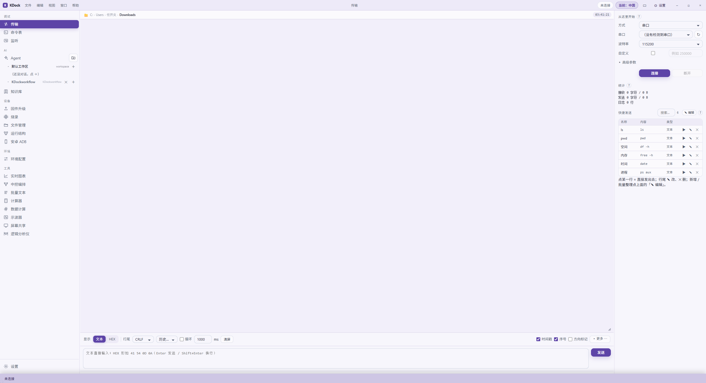
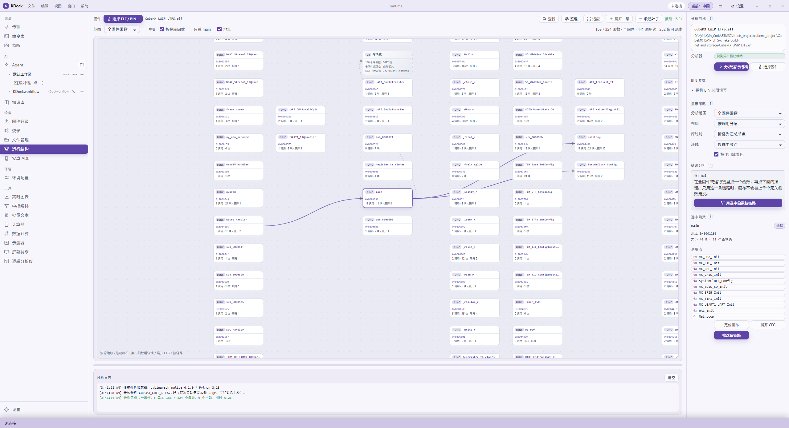
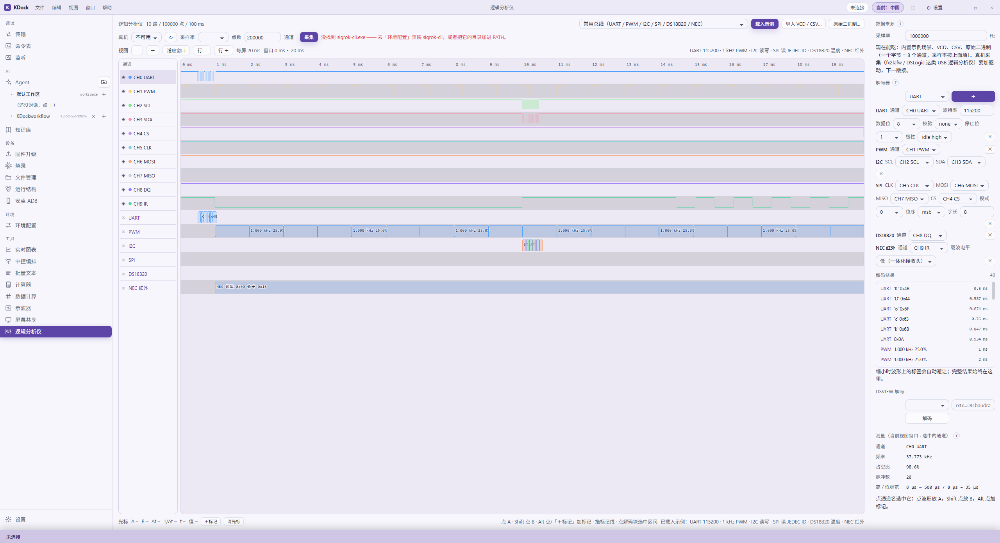
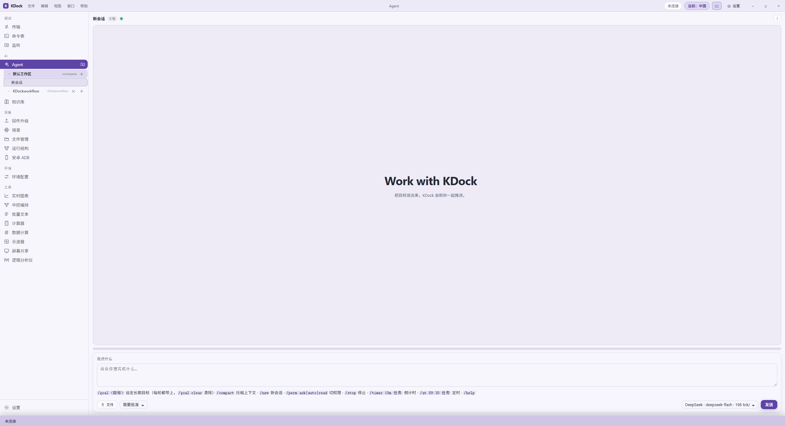

<div align="center">


# KDock

**嵌入式调试工作台 + 可调用全部工具的 Agent**

串口、网络、烧录、设备、固件分析、仪器与流程编排，集中在一个桌面窗口。

[](LICENSE)


**中文** ｜ [English](README.en.md)

</div>

---

## 目录

- [下载与运行](#下载与运行)
- [能做什么](#能做什么)
- [如何协作](#如何协作)
- [从源码编译](#从源码编译)
- [界面展示](#界面展示)
- [项目目录](#项目目录)
- [开源依赖与许可](#开源依赖与许可)
- [文档](#文档)

## 下载与运行

目前只有跟随 `main` 自动构建的 **Pre-release 测试版**：

**[下载最新测试版](https://github.com/Kyin-code/KDock/releases/tag/test-latest)**

- `KDock-*-win-x64.zip`：免安装，解压后运行 `KDock.exe`
- `KDock_*_x64-setup.exe`：NSIS 安装包
- `kdock.exe`：裸可执行文件

需要 Windows x64 和 WebView2 Runtime。程序未签名，首次运行可能触发 SmartScreen；
测试版可能改配置或崩溃，请先备份。

## 能做什么

- **连接**：串口、TCP/UDP、SSH、USBPcap、tshark。
- **设备**：`.fw` 升级、OpenOCD/J-Link、设备文件、FTP/FTPS/TFTP、ADB。
- **分析**：ELF/BIN 运行结构、调用链、CFG、逻辑分析仪。
- **工具**：示波器、命令表、实时图表、批量文本、计算器、中控编排。
- **Agent**：对话、技能、MCP、工作区、权限审批与设备分析。

## 如何协作

- **Agent**：描述目标，由 Agent 调用工具并按权限请求确认。
- **自动化**：用工作流、`AGENTS.md`、技能和 MCP 固化操作与项目规范。
- **开发**：提交 Issue / PR；合并前通过 `cargo test --workspace --locked` 和 `npm run build`。

## 从源码编译

需要 Windows x64、Node.js 18+、Rust 1.80+（MSVC 工具链）和 Tauri 2 依赖。

```powershell
git clone https://github.com/Kyin-code/KDock.git
cd KDock
npm ci

# 首次构建“运行结构”分析器，约 500 MB
pwsh -NoProfile -ExecutionPolicy Bypass -File tools/bingraph/build-portable.ps1 -NoGraphviz

# 开发
npm run tauri dev

# 测试与正式出包
cargo test --workspace --locked
npm run tauri build
```

产物：

- `target/release/kdock.exe`
- `target/release/bundle/nsis/KDock_0.3.0_x64-setup.exe`

不要直接用 `cargo build --release` 代替 Tauri 打包，否则前端资源和 `devUrl` 配置不会完整。

## 界面展示

> 仅作界面展示，详细操作请按 F1 查看上下文帮助。

| 主工作台 | 运行结构 |
| --- | --- |
|  |  |

| 逻辑分析仪 | Agent |
| --- | --- |
|  |  |

## 项目目录

```text
src/                    Vite 前端
src-tauri/              Tauri 2 / Rust 后端与 Agent
crates/kdock-core/      串口、HEX、行尾、会话等核心库
tools/bingraph/         便携固件分析器源码与构建脚本
resources/bingraph/     构建产物，不进入 Git
docs/                   协议、算法与功能文档
```

## 开源依赖与许可

KDock 自身采用 [Apache-2.0](LICENSE)。

核心开源项目：

| 项目 | 用途 | 许可 |
| --- | --- | --- |
| [Tauri](https://github.com/tauri-apps/tauri) | 桌面框架 | MIT OR Apache-2.0 |
| [uPlot](https://github.com/leeoniya/uPlot) | 实时曲线 | MIT |
| [pybingraph](https://github.com/manelfx/pybingraph) | 固件函数/CFG 分析 | BSD-2-Clause |
| [angr](https://angr.io/) | 二进制分析与符号执行 | BSD-2-Clause |
| [Python](https://www.python.org/) | 便携分析器运行时 | PSF-2.0 |
| [Cytoscape.js](https://js.cytoscape.org/) | 分析器离线页面图形 | MIT |

固件分析器在**独立 Python 子进程**中运行；发行包保留 78 个 Python distributions
的许可证与第三方声明。`pyvex` 内含 LibVEX（`GPL-2.0-or-later`），KDock 不修改，
仅在独立进程中使用。完整边界见 [NOTICE](NOTICE) 与
[第三方清单](tools/bingraph/THIRD_PARTY_NOTICES.md)。

USBPcap、tshark、sigrok、ADB/scrcpy、DSView、J-Link、OpenOCD 等为可选外部工具，
KDock 只调用用户安装的程序，不打包或再许可其代码。

## 文档

- [固件包与升级协议](docs/01-固件包格式与打包算法.md)
- [烧录与外部烧录器](docs/05-烧录-外部烧录器.md)
- [设备文件传输](docs/06-设备文件传输.md)
- [逻辑分析仪自测](docs/09-逻辑分析仪-准确性与解码自测.md)
- [固件运行结构分析器](docs/10-固件运行结构分析器.md)
- [更新日志](CHANGELOG.md)
