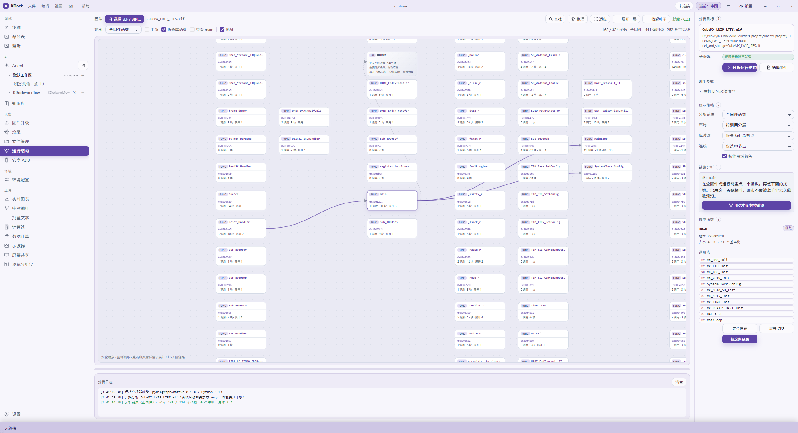
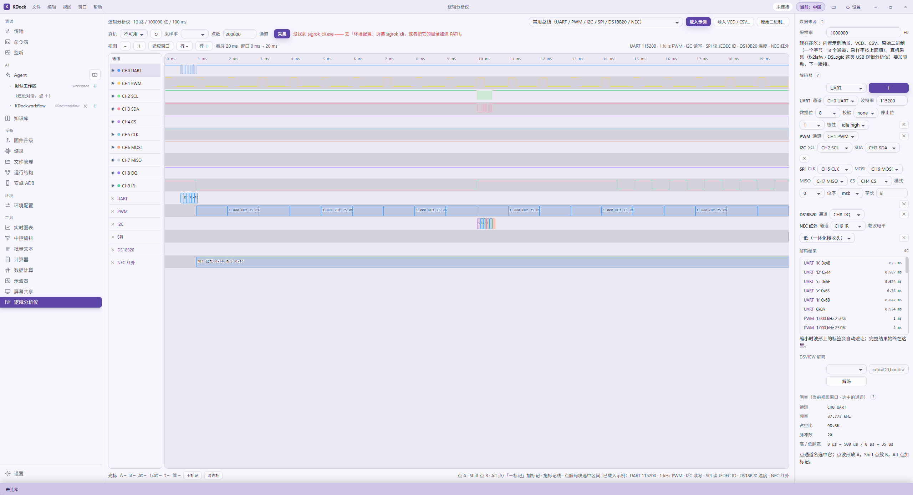

<div align="center">


# KDock

**把串口调试、烧录、固件分析和 AI Agent 放进同一个 Windows 工作台。**

从连接设备到定位问题，再到烧录和自动化，不用在多个软件之间反复复制粘贴。

[](https://github.com/Kyin-code/KDock/actions/workflows/ci.yml)
[](https://github.com/Kyin-code/KDock/releases/tag/test-latest)
[](LICENSE)


**中文** ｜ [English](README.en.md)

</div>

## 为什么是 KDock

- **一条链路贯穿调试流程**：串口、网络、SSH、设备文件、烧录、固件分析和仪器共享同一套上下文。
- **Agent 不只写建议**：它能调用 KDock 的真实工具，读写工程、操作设备、执行命令，并按权限等待确认。
- **面向嵌入式现场**：从 ELF/BIN 调用链到寄存器、逻辑波形和固件升级，重点解决桌面上真实发生的调试工作。

## 2 分钟上手

1. 打开 [test-latest](https://github.com/Kyin-code/KDock/releases/tag/test-latest)。
2. 下载 `KDock-*-win-x64.zip`，解压后运行 `KDock.exe`。
3. 在“传输”页连接串口或网络；其他页面按 `F1` 查看当前功能说明。

也提供 `KDock_*_x64-setup.exe` 安装包。需要 Windows x64 和 WebView2 Runtime。

> 当前是自动构建的 Pre-release，程序未签名，首次运行可能出现 SmartScreen。
> 更新由应用内下载并校验 SHA-256，安装前仍需手动确认。

## 能做什么

| 场景 | 能力 |
| --- | --- |
| 连接与传输 | 串口、TCP/UDP、SSH、USBPcap、tshark、FTP/FTPS/TFTP |
| 设备与烧录 | `.fw` 升级、厂商 Bootloader、OpenOCD/J-Link/pyOCD/WCH-Link、ADB |
| 固件分析 | ELF/BIN 运行结构、函数调用链、上下游高亮、CFG、中断与 RTOS 识别 |
| 仪器与数据 | 示波器、逻辑分析仪、实时图表、批量文本、计算器、中控编排 |
| Agent 与自动化 | 工作区、技能、MCP、共享浏览器、Windows UI 自动化、子 Agent、命令沙箱、定时任务 |

Agent 支持 OpenAI-compatible 与 Anthropic 接口，可接入自己的模型供应商。
常用调试步骤可以固化成工作流、技能或 `AGENTS.md`，下次直接复用。

## 从源码编译

需要 Windows x64、Node.js 18+、Rust 1.80+（MSVC 工具链）和 Tauri 2 依赖。

```powershell
git clone https://github.com/Kyin-code/KDock.git
cd KDock
npm ci

# 首次构建“运行结构”分析器，约 500 MB
pwsh -NoProfile -ExecutionPolicy Bypass -File tools/bingraph/build-portable.ps1 -NoGraphviz

# 开发
npm run tauri dev

# 测试
npm run test:vite:pages
cargo test --workspace --locked

# 正式出包（自动递增版本）
npm run tauri build
```

产物位于：

```text
target/release/kdock.exe
target/release/bundle/nsis/KDock_<version>_x64-setup.exe
```

不要直接用 `cargo build --release` 代替 Tauri 打包；前端资源不会完整进入安装包。

## 界面展示

> 截图仅展示界面；实际操作以应用内 `F1` 帮助为准。

| 运行结构分析 | 逻辑分析仪 |
| --- | --- |
|  |  |

## 项目结构

```text
src/                    Vite 前端
src-tauri/              Tauri 2 / Rust 后端与 Agent
crates/kdock-core/      串口、HEX、行尾、会话等核心库
tools/bingraph/         便携固件分析器源码与构建脚本
resources/bingraph/     构建产物，不进入 Git
docs/                   协议、算法与功能文档
```

## 参与贡献

- 遇到问题请提交 Issue，带上 KDock 版本、系统版本和相关日志。
- 提交 PR 前请运行 `npm run test:vite:pages`、`npm run build` 和 `cargo test --workspace --locked`。
- 新功能请尽量同时补充帮助文档、测试和必要的第三方许可说明。

## 开源依赖与许可

KDock 自身采用 [Apache-2.0](LICENSE)。主要开源依赖：

| 项目 | 用途 | 许可 |
| --- | --- | --- |
| [Tauri](https://github.com/tauri-apps/tauri) | 桌面框架 | MIT OR Apache-2.0 |
| [uPlot](https://github.com/leeoniya/uPlot) | 实时曲线 | MIT |
| [pybingraph](https://github.com/manelfx/pybingraph) | 固件函数/CFG 分析 | BSD-2-Clause |
| [angr](https://angr.io/) | 二进制分析与符号执行 | BSD-2-Clause |
| [Python](https://www.python.org/) | 便携分析器运行时 | PSF-2.0 |
| [Cytoscape.js](https://js.cytoscape.org/) | 分析器离线页面图形 | MIT |

固件分析器运行在独立 Python 子进程中。发行包保留 78 个 Python distributions
的许可证与第三方声明；`pyvex` 内含的 LibVEX（`GPL-2.0-or-later`）未被修改，
仅在该独立进程中使用。完整边界见 [NOTICE](NOTICE) 与
[第三方清单](tools/bingraph/THIRD_PARTY_NOTICES.md)。

USBPcap、tshark、sigrok、ADB/scrcpy、DSView、J-Link、OpenOCD 等为可选外部工具。
KDock 只调用用户安装的程序，不打包或再许可其代码。

## 文档

- [固件包与升级协议](docs/01-固件包格式与打包算法.md)
- [烧录与外部烧录器](docs/05-烧录-外部烧录器.md)
- [设备文件传输](docs/06-设备文件传输.md)
- [逻辑分析仪自测](docs/09-逻辑分析仪-准确性与解码自测.md)
- [固件运行结构分析器](docs/10-固件运行结构分析器.md)
- [模型思考强度与测试](docs/11-模型思考强度与测试.md)
- [更新日志](CHANGELOG.md)
